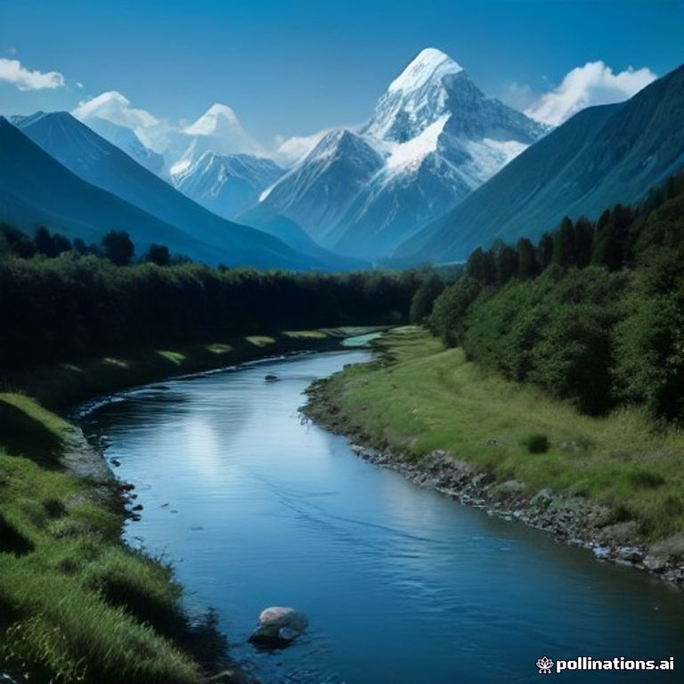
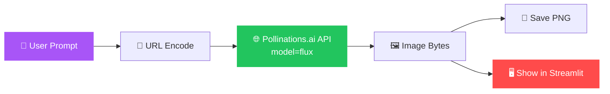

<!-- ===================== HEADER ===================== -->
<div align="center">


<a href="https://git.io/typing-svg">
  
</a>

<br/>


<br/><br/>


</div>

---

## 🎨 Preview

<div align="center">



<sub><i>Prompt: "A beautiful landscape with mountains and a river" — generated with FLUX</i></sub>

</div>

---

## ✨ Features


- 🖌️ **Text-to-Image** — type a prompt, get an image
- ⚡ **FLUX model** through the free Pollinations.ai endpoint
- 🖥️ **Streamlit UI** — clean, interactive, runs in the browser
- 💾 **Save locally** — generated images are written to `generated_image.png`
- 🔐 **Secure config** — API keys kept in `.env` via `python-dotenv`
- 🖼️ **Pillow** for image handling and display

<br clear="right"/>

---

## 🛠️ Tech Stack

<div align="center">

| Layer | Technology |
|:---:|:---:|
| Language |  |
| Web UI |  |
| Image Model |  |
| Image API |  |
| Hub / Models |  |
| Imaging |  |

</div>

---

## 🔄 How It Works



---

## 📂 Project Structure

```
📦 ai-image-generator
 ┣ 📜 app.py              # Streamlit app (main UI)
 ┣ 📜 test_image.py       # Quick CLI test for the image API
 ┣ 📜 requirements.txt    # Dependencies
 ┣ 🖼️ generated_image.png  # Sample output
 ┗ 📜 README.md
```

---

## 🚀 Getting Started

### 1️⃣ Clone the repository

```bash
git clone https://github.com/YOUR_USERNAME/YOUR_REPO.git
cd YOUR_REPO
```

### 2️⃣ Create a virtual environment *(recommended)*

```bash
python -m venv venv

# Windows
venv\Scripts\activate

# macOS / Linux
source venv/bin/activate
```

### 3️⃣ Install dependencies

```bash
pip install -r requirements.txt
```

### 4️⃣ Add your environment variables *(if needed)*

Create a `.env` file in the project root:

```env
HF_TOKEN=your_huggingface_token_here
```

### 5️⃣ Run the app

```bash
streamlit run app.py
```

Open **http://localhost:8501** and start creating 🎉

---

## 🧪 Quick Test (no UI)

Verify the image API works from the command line:

```bash
python test_image.py
```

The core request looks like this:

```python
import requests
from urllib.parse import quote

prompt = "A beautiful landscape with mountains and a river"
url = f"https://image.pollinations.ai/prompt/{quote(prompt)}?model=flux"

response = requests.get(url, timeout=100)
if response.status_code == 200:
    with open("generated_image.png", "wb") as f:
        f.write(response.content)
    print("IMAGE GENERATED SUCCESSFULLY")
```

> 💡 **Note:** the `?` before `model=flux` is required — without it the model parameter becomes part of the prompt text and is ignored.

---

## 🧠 Prompt Tips

| ✅ Do | ❌ Avoid |
|---|---|
| Be specific: *"misty pine forest at sunrise, cinematic lighting"* | Vague prompts: *"nice picture"* |
| Add style: *"watercolor"*, *"3D render"*, *"photorealistic"* | Overly long, contradictory prompts |
| Mention lighting, mood and camera angle | Asking for text-heavy images |

---

## 🗺️ Roadmap

- [x] Basic text-to-image generation
- [x] Save output as PNG
- [ ] Image size / aspect-ratio controls
- [ ] Multiple model selection
- [ ] Prompt history gallery
- [ ] One-click download button
- [ ] Deploy to Streamlit Community Cloud

---

## 🤝 Contributing

Contributions, issues and feature requests are welcome!

1. Fork the project
2. Create your feature branch (`git checkout -b feature/AmazingFeature`)
3. Commit your changes (`git commit -m 'Add AmazingFeature'`)
4. Push to the branch (`git push origin feature/AmazingFeature`)
5. Open a Pull Request

---

## 👨‍💻 Author

<div align="center">

**Vanamala Jayasurya**
*B.Tech CSE (Data Science) Graduate • Software · Data · AI*

<a href="https://jayasuryaportfilio.vercel.app"></a>
<a href="https://linkedin.com/in/vanamala-jayasurya-5b1138324"></a>

<br/><br/>

⭐ **If you like this project, give it a star!** ⭐

</div>

<!-- ===================== FOOTER ===================== -->

